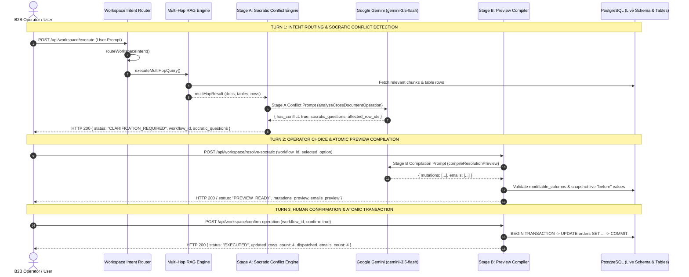

# End-to-End Walkthrough of the B2B Multi-Hop RAG & Socratic Governance Pipeline

This document provides a comprehensive, function-by-function technical walkthrough of the **Echo B2B Autonomous Operations & Governance Pipeline**. It traces the entire execution lifecycle of a complex user instruction:

> **Example Test Directive:**  
> *"Find all undelivered or processing orders in orders.csv containing defective batches from the QA Batch Recall report, swap them to clean replacement batches with expedited shipping per our Refund & Replacement SOP, and email the customers their updated fulfillment details."*

It details how this request enters the system, navigates intent routing, executes hybrid multi-hop RAG, passes through the AI Socratic governance gate, deterministically compiles database diffs and emails, and safely executes atomic database mutations.

---

## 1. High-Level Pipeline Architecture & Turn Lifecycle

The pipeline operates as a **3-Turn Governed Execution Loop**, ensuring that no destructive action, price change, or customer communication is ever executed without explicit, policy-grounded human alignment:



---

## 2. Turn 1: User Input $\rightarrow$ Intent Routing $\rightarrow$ Socratic Conflict Detection

### 2.1 Route Entry & Workspace Validation
* **Route Endpoint:** `POST /api/workspace/execute`
* **Route Definition:** [`backend/src/routes/workspaceRoutes.js`](file:///c:/Users/USER/Desktop/Development/Echo/backend/src/routes/workspaceRoutes.js#L19)
* **Controller Handler:** `executeOperation(req, res, next)` in [`backend/src/controllers/workspaceController.js`](file:///c:/Users/USER/Desktop/Development/Echo/backend/src/controllers/workspaceController.js#L270-L292)

**What happens here:**
1. `requireBusinessId(req)` resolves and verifies the tenant ID (`11111111-2222-3333-4444-555555555555`) against the `businesses` table.
2. Extracts the `prompt` string and optional active `entity` from `req.body`.
3. Calls the core service orchestrator: `executeWorkspaceOperation({ businessId, prompt, entity, history })`.

---

### 2.2 Intent Classification
* **Function:** `routeWorkspaceIntent({ businessId, prompt, entity, history })`
* **Source File:** [`backend/src/services/workspaceIntentRouter.js`](file:///c:/Users/USER/Desktop/Development/Echo/backend/src/services/workspaceIntentRouter.js#L101-L279)

**What happens here:**
1. **Conversational Fast-Check:** Calls `detectConversationalIntent(prompt)`. Pure greetings (e.g. *"Hello"*) return immediately without calling the database. For operational prompts, this returns `false`.
2. **Context Discovery:** Calls `discoverWorkspaceSources(businessId)` to find all tables attached to this workspace (`orders`, row count: 20) and all indexed documents (`QA_Batch_Recall.pdf`, `Refund_Compliance_SOP.pdf`).
3. **Retrieval Fast-Probe:** Calls `retrieveHybridDocumentChunks(businessId, prompt, { topK: 12 })` to fetch initial semantic excerpts.
4. **Structured Intent Prompting:** Calls `generateStructuredJsonWithRetry` invoking Gemini with `WORKSPACE_INTENT_SCHEMA`.
5. **Classification Result:** Gemini classifies the prompt as `cross_document_operation` because it involves applying policy rules from uploaded documents to database records. It sets:
   ```json
   {
     "intent": "cross_document_operation",
     "entity": "orders",
     "target_entities": ["orders"]
   }
   ```
6. `resolveTableName` validates `orders` against the active workspace schema, locking `authoritativeEntity = "orders"`.

---

### 2.3 Multi-Hop Context Assembly (Hop 1 & Hop 2)
* **Function:** `executeMultiHopQuery(businessId, effectivePrompt, options)`
* **Source File:** [`backend/src/services/queryRouterService.js`](file:///c:/Users/USER/Desktop/Development/Echo/backend/src/services/queryRouterService.js#L718-L790)

**What happens here:**
1. **Hop 1 (Document Extraction):** Calls `retrieveHybridDocumentChunks` in [`crossRagService.js`](file:///c:/Users/USER/Desktop/Development/Echo/backend/src/services/crossRagService.js#L80-L160).
   - Generates vector embeddings for the prompt via `generateEmbedding` in [`geminiService.js`](file:///c:/Users/USER/Desktop/Development/Echo/backend/src/services/geminiService.js).
   - Performs cosine similarity and keyword matching against `workspace_document_chunks`.
   - Retrieves the critical chunks from `QA_Batch_Recall.pdf` (defective batches `B-404`, `B-409`; clean replacement batch `B-501`) and `Refund_Compliance_SOP.pdf` (Pre-Shipment Replacement & Salvage Clause).
   - Executes `extractHop1RulesAndEntities(retrievedChunks, tables, prompt)` to isolate the domain entities.
2. **Hop 2 (Relational Resolution):** Calls `executeHop2RelationalResolution(tables, hop1, prompt, authoritativeEntity)`.
   - Binds the extracted defective batch codes (`B-404`, `B-409`) to the relational table `orders`.
   - Loads the 20 live rows from `orders` and extracts column definitions via [`sheetSchemaService.js`](file:///c:/Users/USER/Desktop/Development/Echo/backend/src/services/sheetSchemaService.js).
   - Loads verified recipient directory via `loadWorkspaceCustomerRecipients`.
3. Returns `multiHopResult` containing `targetTables`, `retrievedChunks`, `hop1`, `hop2`, and `workspaceCustomers`.

---

### 2.4 Stage A: AI Socratic Conflict Analysis & Question Generation
* **Function:** `analyzeCrossDocumentOperation(multiHopResult, effectivePrompt)`
* **Source File:** [`backend/src/services/socraticOperationsService.js`](file:///c:/Users/USER/Desktop/Development/Echo/backend/src/services/socraticOperationsService.js#L773-L1190)

This is the primary function responsible for generating **AI B2B suggestions & Socratic trade-off questions**.

**What happens inside this function:**
1. **Schema & Row Projection:**
   - Calls `projectTableForLlm(targetTable)`.
   - Extracts modifiable columns: `Order_ID`, `Customer_Name`, `Customer_Email`, `Batch_Code`, `Shipping_Tier`, `Dispatch_Status`, `Promo_Discount_Pct`, etc.
   - Formats candidate rows into a JSON array tagged with `_row_id`.
2. **Building the Analysis Prompt (`analysisPrompt`):**
   - Injects the `USER_INSTRUCTION`.
   - Injects `UPLOADED_DOCUMENTS` (the exact chunks containing the QA bulletin and Refund SOP).
   - Injects `TARGET_TABLE_ROWS` (the 20 live rows from `orders`).
   - Injects `MODIFIABLE_COLUMNS`.
   - Enforces the **Strict Evaluation Protocol**:
     * Step 1: Verify `dataset_compatible: true`.
     * Step 2: Superset eligibility filtering for `affected_row_ids` (must match defective batches in undelivered/processing states).
     * Step 3: Governance conflict detection for `conflicting_row_ids` and generation of `socratic_questions`.
3. **Structured Gemini Invocation:**
   - Calls `generateStructuredJsonWithRetry` with `SOCRATIC_ANALYSIS_SCHEMA`.
4. **Gemini's Reasoning on the Example Prompt:**
   - **Target Rows Identified (`affected_row_ids`):**
     * `ORD-2026-1015`: Batch `B-404`, `Dispatch_Status: "Processing"`, `Promo_Discount_Pct: 0`
     * `ORD-2026-1017`: Batch `B-409`, `Dispatch_Status: "Processing"`, `Promo_Discount_Pct: 0`
     * `ORD-2026-1018`: Batch `B-404`, `Dispatch_Status: "Processing"`, `Promo_Discount_Pct: 10`
     * `ORD-2026-1020`: Batch `B-409`, `Dispatch_Status: "Processing"`, `Promo_Discount_Pct: 15`
     *(Orders in "Shipped" or "Delivered" states are excluded because the prompt explicitly scoped to "undelivered or processing orders".)*
   - **Policy Conflict Detected (`conflicting_row_ids`):**
     * `Refund_Compliance_SOP.pdf`, Section 4 states: *"Orders receiving a clean-batch swap upgraded to expedited shipping cannot stack with existing promotional discounts."*
     * `ORD-2026-1018` (10% discount) and `ORD-2026-1020` (15% discount) violate this policy clause!
   - **Generated Socratic Clarification Question:**
     * `question_id`: `"preshipment_promo_conflict_resolution"`
     * `question_text`: `"Orders ORD-2026-1018 and ORD-2026-1020 carry existing promotional discounts (10% and 15%). The Refund & Replacement SOP Section 4 restricts stacking promotional discounts with complimentary expedited replacement shipping. How should these conflicting orders be handled?"`
     * **Option 1 (Waive Restriction / Preserve Promo):**
       `"Execute the clean-batch swap to B-501 and upgrade to Expedited shipping for all 4 orders while waiving the policy restriction to preserve existing promotional discounts for ORD-2026-1018 (10%) and ORD-2026-1020 (15%)."`
     * **Option 2 (Enforce SOP Cap / Strip Promo):**
       `"Execute the clean-batch swap to B-501 and upgrade to Expedited shipping, but strictly enforce the SOP cap by resetting Promo_Discount_Pct to 0% on ORD-2026-1018 and ORD-2026-1020."`
5. **State Persistence & Citations:**
   - Calls `buildCrossSourceCitations` in [`crossRagService.js`](file:///c:/Users/USER/Desktop/Development/Echo/backend/src/services/crossRagService.js#L260-L310) linking chunk citations to row IDs.
   - Generates a UUID `workflowId` (e.g. `84d1b685-ab45-4dcd-a6d9-e6c95b11ca9f`).
   - Calls `saveWorkflowState` storing the workflow in memory (`WORKFLOW_STORE`).
   - Returns HTTP 200 with contract:
     ```json
     {
       "status": "CLARIFICATION_REQUIRED",
       "workflow_id": "84d1b685-ab45-4dcd-a6d9-e6c95b11ca9f",
       "conflict_summary": "4 processing orders contain defective batches B-404 and B-409. Orders ORD-2026-1018 and ORD-2026-1020 carry promotional discounts that conflict with the Pre-Shipment Replacement SOP promo cap.",
       "affected_rows_count": 4,
       "conflicting_rows_count": 2,
       "socratic_questions": [...],
       "citations": [...]
     }
     ```

---

## 3. Turn 2: Socratic Resolution $\rightarrow$ AI Preview Compilation

### 3.1 Route Entry & Choice Mapping
* **Route Endpoint:** `POST /api/workspace/resolve-socratic`
* **Route Definition:** [`backend/src/routes/workspaceRoutes.js`](file:///c:/Users/USER/Desktop/Development/Echo/backend/src/routes/workspaceRoutes.js#L20)
* **Controller Handler:** `resolveSocratic(req, res, next)` in [`backend/src/controllers/workspaceController.js`](file:///c:/Users/USER/Desktop/Development/Echo/backend/src/controllers/workspaceController.js#L299-L320)
* **Service Orchestrator:** `resolveSocraticWorkflow({ workflowId, selectedOptions, businessId })` in [`backend/src/services/socraticOperationsService.js`](file:///c:/Users/USER/Desktop/Development/Echo/backend/src/services/socraticOperationsService.js#L1811-L1865)

**What happens here:**
1. Loads existing workflow state from `WORKFLOW_STORE` via `loadWorkflowState(workflowId)`.
2. Validates that `workflow.status === 'CLARIFICATION_REQUIRED'`.
3. Calls `resolveSelectedOption(selectedOptions, workflow.socratic_questions)`:
   - Matches the operator's payload (e.g. `"Option_1"` or `"Option_2"`) against the registered options.
   - Extracts the authoritative `optionId` and `optionMeta` (including `rule_interpretation`).

---

### 3.2 Stage B: Deterministic Mutation & Email Compilation
* **Function:** `compileResolutionPreview(workflow, optionId, optionMeta)`
* **Source File:** [`backend/src/services/socraticOperationsService.js`](file:///c:/Users/USER/Desktop/Development/Echo/backend/src/services/socraticOperationsService.js#L1250-L1620)

This is the function responsible for transforming the operator's choice into **exact row-level database mutations and personalized email notification previews**.

**What happens inside this function:**
1. **Filtering Candidate Rows:** Restricts `candidateProjectedRows` to the 4 affected rows (`ORD-2026-1015`, `ORD-2026-1017`, `ORD-2026-1018`, `ORD-2026-1020`).
2. **Filtering Recipient Directory:** Isolates the customer emails and contact names for those 4 rows (`Marcus Vance`, `Sophia Patel`, `Liam Chen`, `Emma Rodriguez`).
3. **Constructing the Stage B Compilation Prompt (`compilePrompt`):**
   - Injects `SELECTED_SOCRATIC_OPTION`: contains the chosen option label and exact `rule_interpretation`.
   - Injects `ALLOWED_RECIPIENTS`: restricts emails strictly to verified order contacts.
   - Injects `MODIFIABLE_COLUMNS` and `CANDIDATE_ROWS`.
   - Enforces **Deterministic Compilation Rules**:
     * Must output exact new values for `Batch_Code` (`"B-501"`), `Shipping_Tier` (`"Expedited"`), and `Dispatch_Status` (`"Ready for Expedited Dispatch"`).
     * If Option 1 is chosen: preserve `Promo_Discount_Pct` on `ORD-2026-1018` (`"10"`) and `ORD-2026-1020` (`"15"`).
     * If Option 2 is chosen: set `Promo_Discount_Pct` to `"0"` on `ORD-2026-1018` and `ORD-2026-1020`.
     * Generate 1 personalized email per recipient addressing the customer by name, citing the order ID, the clean batch swap, and expedited tracking.
4. **Structured Gemini Invocation:**
   - Calls `generateStructuredJsonWithRetry` with `PREVIEW_COMPILATION_SCHEMA`.
5. **Schema & Snapshot Verification:**
   - For every mutation returned by Gemini:
     * Resolves the row in PostgreSQL to snapshot the actual `before` values.
     * Validates that every modified column exists in `modifiable_columns` and is not virtual/read-only.
     * Computes the exact `diff` (`before` $\rightarrow$ `after`).
6. **State Transition:**
   - Updates `workflow.status = 'PREVIEW_READY'`.
   - Stores `mutations_preview` and `emails_preview` in the workflow state.
   - Returns HTTP 200:
     ```json
     {
       "status": "PREVIEW_READY",
       "workflow_id": "84d1b685-ab45-4dcd-a6d9-e6c95b11ca9f",
       "mutations_preview": [
         {
           "table_name": "orders",
           "row_identifier": "ORD-2026-1015",
           "before": { "Batch_Code": "B-404", "Shipping_Tier": "Standard", "Dispatch_Status": "Processing" },
           "after": { "Batch_Code": "B-501", "Shipping_Tier": "Expedited", "Dispatch_Status": "Ready for Expedited Dispatch" }
         },
         {
           "table_name": "orders",
           "row_identifier": "ORD-2026-1017",
           "before": { "Batch_Code": "B-409", "Shipping_Tier": "Standard", "Dispatch_Status": "Processing" },
           "after": { "Batch_Code": "B-501", "Shipping_Tier": "Expedited", "Dispatch_Status": "Ready for Expedited Dispatch" }
         },
         {
           "table_name": "orders",
           "row_identifier": "ORD-2026-1018",
           "before": { "Batch_Code": "B-404", "Shipping_Tier": "Standard", "Dispatch_Status": "Processing", "Promo_Discount_Pct": "10" },
           "after": { "Batch_Code": "B-501", "Shipping_Tier": "Expedited", "Dispatch_Status": "Ready for Expedited Dispatch" }
         },
         {
           "table_name": "orders",
           "row_identifier": "ORD-2026-1020",
           "before": { "Batch_Code": "B-409", "Shipping_Tier": "Standard", "Dispatch_Status": "Processing", "Promo_Discount_Pct": "15" },
           "after": { "Batch_Code": "B-501", "Shipping_Tier": "Expedited", "Dispatch_Status": "Ready for Expedited Dispatch" }
         }
       ],
       "emails_preview": [
         {
           "recipient_email": "marcus.vance@example.com",
           "recipient_name": "Marcus Vance",
           "subject": "Fulfillment Update: Order ORD-2026-1015 Batch Replacement",
           "body": "Dear Marcus Vance, your order ORD-2026-1015 has been upgraded to clean replacement batch B-501 with complimentary Expedited shipping per QA bulletin..."
         },
         ... (4 emails total)
       ]
     }
     ```

---

## 4. Turn 3: Human Confirmation $\rightarrow$ Atomic Execution

### 4.1 Route Entry & Authorization Check
* **Route Endpoint:** `POST /api/workspace/confirm-operation`
* **Route Definition:** [`backend/src/routes/workspaceRoutes.js`](file:///c:/Users/USER/Desktop/Development/Echo/backend/src/routes/workspaceRoutes.js#L21)
* **Controller Handler:** `confirmOperation(req, res, next)` in [`backend/src/controllers/workspaceController.js`](file:///c:/Users/USER/Desktop/Development/Echo/backend/src/controllers/workspaceController.js#L326-L344)
* **Service Orchestrator:** `confirmWorkspaceOperation({ workflowId, businessId, confirm, dryRun })` in [`backend/src/services/socraticOperationsService.js`](file:///c:/Users/USER/Desktop/Development/Echo/backend/src/services/socraticOperationsService.js#L1890-L2045)

**What happens here:**
1. Verifies that `confirm === true`. (If `confirm === false`, immediately throws HTTP 400 *'Operation was cancelled or not confirmed'*).
2. Verifies that `workflow.status === 'PREVIEW_READY'`.
3. Verifies tenant boundaries (`workflow.business_id === businessId`).

---

### 4.2 Atomic PostgreSQL Transaction
* **Function:** `withTransaction(async (client) => { ... })`
* **Source File:** [`backend/db/index.js`](file:///c:/Users/USER/Desktop/Development/Echo/backend/db/index.js)

**Execution steps:**
1. Issues `BEGIN` in PostgreSQL.
2. Iterates over `workflow.mutations_preview`:
   - Builds parameterized SQL `UPDATE` statements using `quoteIdentifier` for safety:
     ```sql
     UPDATE "orders" 
     SET "Batch_Code" = $2, "Shipping_Tier" = $3, "Dispatch_Status" = $4
     WHERE "business_id" = $1 AND "Order_ID"::text = $5;
     ```
   - Executes with parameters: `['11111111-2222-3333-4444-555555555555', 'B-501', 'Expedited', 'Ready for Expedited Dispatch', 'ORD-2026-1015']`.
   - Checks `res.rowCount > 0`. If any row was concurrently deleted, triggers a rollback (`ROLLBACK`).
3. Repeats for all 4 qualifying orders.
4. Issues `COMMIT`.

---

### 4.3 Notification Dispatch & Audit Recording
* **Function:** `sendIndividualEmail` in [`backend/src/services/emailService.js`](file:///c:/Users/USER/Desktop/Development/Echo/backend/src/services/emailService.js)
* **Storage:** `DISPATCHED_EMAILS_BY_WORKFLOW.set(workflowId, dispatchedEmails)` in [`socraticOperationsService.js`](file:///c:/Users/USER/Desktop/Development/Echo/backend/src/services/socraticOperationsService.js#L37)

**Execution steps:**
1. Dispatches or queues 4 outgoing emails to Marcus Vance, Sophia Patel, Liam Chen, and Emma Rodriguez.
2. Logs dispatched payloads in the audit ledger.
3. Updates `workflow.status = 'EXECUTED'`.
4. Returns HTTP 200 final execution summary:
   ```json
   {
     "status": "EXECUTED",
     "workflow_id": "84d1b685-ab45-4dcd-a6d9-e6c95b11ca9f",
     "updated_rows_count": 4,
     "dispatched_emails_count": 4,
     "dispatched_emails": [...],
     "citations": [...]
   }
   ```

---

## 5. Function Responsibility Reference Matrix

The following table summarizes every function in the codebase responsible for converting the user's input into AI-generated suggestions, previews, and database mutations:

| Pipeline Phase | Function Name | File Location | Key Responsibility |
| :--- | :--- | :--- | :--- |
| **API Entry** | `executeOperation` | [`workspaceController.js`](file:///c:/Users/USER/Desktop/Development/Echo/backend/src/controllers/workspaceController.js#L270) | Receives HTTP POST `/api/workspace/execute`, validates business ID. |
| **Orchestration** | `executeWorkspaceOperation` | [`socraticOperationsService.js`](file:///c:/Users/USER/Desktop/Development/Echo/backend/src/services/socraticOperationsService.js#L1623) | Controls overall 3-turn workflow state machine and router dispatch. |
| **Intent Routing** | `routeWorkspaceIntent` | [`workspaceIntentRouter.js`](file:///c:/Users/USER/Desktop/Development/Echo/backend/src/services/workspaceIntentRouter.js#L101) | Classifies prompt intent as `cross_document_operation` and resolves target table `orders`. |
| **Multi-Hop RAG** | `executeMultiHopQuery` | [`queryRouterService.js`](file:///c:/Users/USER/Desktop/Development/Echo/backend/src/services/queryRouterService.js#L718) | Manages Hop 1 (document chunks) and Hop 2 (relational table rows) context assembly. |
| **Hybrid Chunk Fetch** | `retrieveHybridDocumentChunks` | [`crossRagService.js`](file:///c:/Users/USER/Desktop/Development/Echo/backend/src/services/crossRagService.js#L80) | Performs vector embedding and keyword retrieval over `workspace_document_chunks`. |
| **Hop 1 Extraction** | `extractHop1RulesAndEntities` | [`queryRouterService.js`](file:///c:/Users/USER/Desktop/Development/Echo/backend/src/services/queryRouterService.js#L620) | Parses document text for recalled batches (`B-404`, `B-409`), clean batches (`B-501`), and clauses. |
| **Hop 2 Resolution** | `executeHop2RelationalResolution` | [`queryRouterService.js`](file:///c:/Users/USER/Desktop/Development/Echo/backend/src/services/queryRouterService.js#L680) | Queries PostgreSQL table `orders` and binds extracted batches to table records. |
| **Stage A (Conflict Gate)** | `analyzeCrossDocumentOperation` | [`socraticOperationsService.js`](file:///c:/Users/USER/Desktop/Development/Echo/backend/src/services/socraticOperationsService.js#L773) | **Generates AI Socratic questions & options**; detects the 2 promotional discount conflicts. |
| **Row Projection** | `projectTableForLlm` | [`socraticOperationsService.js`](file:///c:/Users/USER/Desktop/Development/Echo/backend/src/services/socraticOperationsService.js#L680) | Extracts modifiable columns and prepares structured JSON rows with `_row_id`. |
| **Citation Builder** | `buildCrossSourceCitations` | [`socraticOperationsService.js`](file:///c:/Users/USER/Desktop/Development/Echo/backend/src/services/socraticOperationsService.js#L260) | Links PDF source page numbers and text excerpts to the affected table rows. |
| **LLM Execution** | `generateStructuredJsonWithRetry` | [`geminiService.js`](file:///c:/Users/USER/Desktop/Development/Echo/backend/src/services/geminiService.js#L60) | Calls Google Gemini API (`gemini-3.5-flash`) enforcing strict JSON response schemas. |
| **Option Resolver** | `resolveSelectedOption` | [`socraticOperationsService.js`](file:///c:/Users/USER/Desktop/Development/Echo/backend/src/services/socraticOperationsService.js#L1201) | Maps user choice (`Option_1` vs `Option_2`) to internal rule interpretations. |
| **Stage B (Preview Compiler)**| `compileResolutionPreview` | [`socraticOperationsService.js`](file:///c:/Users/USER/Desktop/Development/Echo/backend/src/services/socraticOperationsService.js#L1250) | **Generates AI B2B suggestion previews**: computes exact 4-row SQL diffs and drafts 4 customer emails. |
| **Stage C (Execution)** | `confirmWorkspaceOperation` | [`socraticOperationsService.js`](file:///c:/Users/USER/Desktop/Development/Echo/backend/src/services/socraticOperationsService.js#L1890) | Validates confirmation flag and coordinates atomic SQL transaction and email dispatches. |
| **Database Transaction** | `withTransaction` | [`backend/db/index.js`](file:///c:/Users/USER/Desktop/Development/Echo/backend/db/index.js) | Executes PostgreSQL `BEGIN ... COMMIT` ensuring atomic zero-corruption updates. |
| **Email Service** | `sendIndividualEmail` | [`emailService.js`](file:///c:/Users/USER/Desktop/Development/Echo/backend/src/services/emailService.js) | Formats and dispatches approved customer notification emails. |

---

## 6. Summary: Key Architectural Strengths

1. **Zero Hardcoded Logic:** No batch codes (`B-404`, `B-501`), promo thresholds, or table names are hardcoded in the service layer. All operational rules are derived dynamically at runtime from the ingested PDF policies and live PostgreSQL schemas.
2. **Socratic Governance Gate:** High-risk operational conflicts (such as promotional discount stacking vs. warranty replacement clauses) are caught **before** execution, preventing unauthorized financial or inventory loss.
3. **Atomic Schema Safety:** Every LLM-suggested update is strictly validated against PostgreSQL column types and modifiable flags before transaction commit.
4. **Transparent Auditability:** Every suggested mutation is presented with live `before` vs. `after` values and clickable cross-source citations to the governing document pages.
