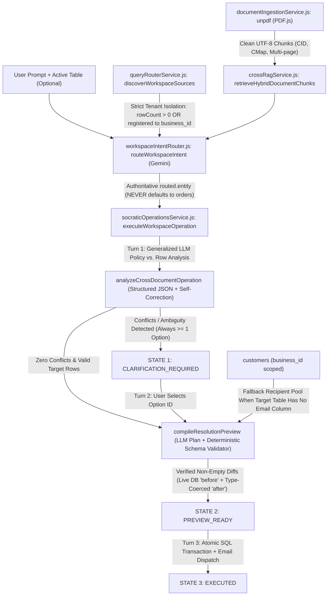

# Generalized Cross-Document Hybrid RAG & Socratic Operations Remediation Plan

## Goal Description

As proven in [stress_test_report.md](file:///C:/Users/USER/.gemini/antigravity/brain/41e3e662-6f46-4fb1-bfc9-01dcdf6a45ec/stress_test_report.md), all **4 stress-test scenarios failed (`0/4`)** despite [`routeWorkspaceIntent`](file:///c:/Users/USER/Desktop/Development/Echo/backend/src/services/workspaceIntentRouter.js#L91-L213) classifying the intent and target table accurately `4/4` times.

The failures stem from five systemic root causes (`D-01`–`D-05`) plus two demo CSV mismatches (`D-06`):
1. **Hardcoded Scenario-0 Regex Engine (`D-01`, `D-05`)**: [`queryRouterService.js`](file:///c:/Users/USER/Desktop/Development/Echo/backend/src/services/queryRouterService.js) and [`socraticOperationsService.js`](file:///c:/Users/USER/Desktop/Development/Echo/backend/src/services/socraticOperationsService.js) make **zero LLM calls** after intent routing. They rely on regexes hardcoded around shipping delay hours, SLA boolean vouchers, and `"SLA-Breached"` statuses—causing misclassified columns (`overdue_balance` treated as delay hours), `16/16` false row matches, hardcoded SLA-voucher Socratic options, and empty `before: {}, after: {}` diffs (`0` DB updates).
2. **Broken Custom Regex PDF Extractor (`D-02`)**: [`extractPagesFromPdf`](file:///c:/Users/USER/Desktop/Development/Echo/backend/src/services/documentIngestionService.js#L157-L320) steps 1 byte at a time through raw PDF streams, corrupting 2-byte Identity-H CID fonts (Scenario 2) and indirect `/Resources` subsetted CMaps + `TJ` kerning arrays (Scenario 1) into unreadable garbage.
3. **Dropped Gemini Target Entity & Empty Table Pollution (`D-03`)**: [`executeWorkspaceOperation`](file:///c:/Users/USER/Desktop/Development/Echo/backend/src/services/socraticOperationsService.js#L624-L626) ignores `routed.entity`, [`executeMultiHopQuery`](file:///c:/Users/USER/Desktop/Development/Echo/backend/src/services/queryRouterService.js#L657) drops `options.targetEntity`, [`discoverWorkspaceSources`](file:///c:/Users/USER/Desktop/Development/Echo/backend/src/services/queryRouterService.js#L223-L283) includes `0`-row tables from other tenants (`orders`, `electronics_inventory`), and [`workspaceController.js`](file:///c:/Users/USER/Desktop/Development/Echo/backend/src/controllers/workspaceController.js#L155) defaults uploaded CSVs to `'orders'`.
4. **Unresolvable `options: []` UI Deadlock (`D-04`)**: [`evaluateSocraticConflicts`](file:///c:/Users/USER/Desktop/Development/Echo/backend/src/services/socraticOperationsService.js#L262-L269) emits `options: []` when parameters are missing, trapping [`SocraticOperationsWorkbench.tsx`](file:///c:/Users/USER/Desktop/Development/Echo/frontend/src/components/SocraticOperationsWorkbench.tsx#L186-L191) in an HTTP `400` error on Turn 2.
5. **Catalog Notification Gap & Document Bleed**: Tables without an inline email column (such as `products` in Scenario 1) cannot notify registered buyers because `customers` is hidden in `SYSTEM_TABLES`, and old PDFs remain in `workspace_documents` across scenario switches on the same `business_id`.

This plan replaces all Scenario-0 regex heuristics with a **100% schema-agnostic, domain-generalized LLM Socratic Analysis & Preview Compiler**, upgrades PDF extraction to **`unpdf` (PDF.js)**, enforces **strict multi-tenant table isolation + authoritative Gemini target-table propagation**, resets the database document store to a **fresh slate**, and requires **all 4 scenarios (plus Scenario 0 and existing unit tests) to pass end-to-end** before completion.

---

## User Review Required

> [!IMPORTANT]
> **Two Live Dataset Findings Discovered During Inspection (Please Confirm Before Execution)**:
> 1. **Scenario 2 (`orders` under `11111111-2222-3333-4444-555555555555`)**:
>    We inspected all `20` rows currently stored in PostgreSQL `orders` for `11111111-2222-3333-4444-555555555555`. Because `POST /api/workspace/demo/seed` was previously run on that business ID, those `20` rows are **Scenario 0's furniture, handbag, and cake orders** (`Extendable Solid Ash Dining Table`, `Croc-Embossed Evening Clutch`, `Red Velvet Cake`, etc.)—with **no `Batch` column** and **zero Echo Workstation hardware units** matching `QA_Batch_Recall.pdf` (`Batch "B-404"`, `Batch "B-409"`, `Gen-4 Dock`, `Studio Compute`).
> 2. **Scenario 4 (`backend/demo/scenario_4/backorders_dataset.csv`)**:
>    Inspecting [backorders_dataset.csv](file:///c:/Users/USER/Desktop/Development/Echo/backend/demo/scenario_4/backorders_dataset.csv) on disk (`2,105` bytes) shows it accidentally contains a single-line copy of Scenario 3's wholesale accounts (`account_id,company_name,...,ACC-1001..ACC-1016`) instead of the open backorders ledger (`BO-2001`–`BO-2013`, `VL-POLO-BLK`, `Priority` vs. `Standard` tier) described in `Port Receiving Manifest.pdf` and `Allocation Priority Policy.pdf`.

> [!WARNING]
> **Fresh-Slate Database Cleanup Scope**:
> Per your directive, Phase 0 of execution will execute `TRUNCATE TABLE workspace_document_chunks, workspace_documents, socratic_workflows RESTART IDENTITY CASCADE;`, clear in-memory caches, drop the corrupted `backorders_dataset` schema so it re-imports cleanly, restore baseline `discount` values on `products` (`684a8863-5094-4c8b-9b15-c50c06335b7f`), and re-upload each scenario's PDFs and CSVs cleanly to their designated business workspaces.

---

## Open Questions

> [!IMPORTANT]
> 1. **Scenario 2 `orders` Dataset**: Would you like us to create `backend/demo/scenario_2/orders.csv` (with Echo Workstation orders spanning batches `B-404`, `B-409`, unaffected batches/accessories, `Cash on Delivery` vs. prepaid `Credit Card`/`Bank Transfer` rails, and existing promo discounts so Scenario 2's full recall + COD/stacking Socratic gate is exercised) and upload it to `11111111-2222-3333-4444-555555555555`, **or** will you upload your own Scenario 2 `orders.csv`?
> 2. **Scenario 4 `backorders_dataset.csv`**: Should we repair [backorders_dataset.csv](file:///c:/Users/USER/Desktop/Development/Echo/backend/demo/scenario_4/backorders_dataset.csv) so its rows match the exact SKU (`VL-POLO-BLK`, `VL-SHIRT-PMB`, `VL-SHIRT-CRL`, `VL-POLO-RIB`) and backorder IDs (`BO-2001`–`BO-2013`, `20` Priority + `40` Standard `Pending` units) specified in Scenario 4's PDFs?

---

## Architecture Overview



---

## Proposed Changes

### Component 1: Spec-Compliant PDF Ingestion & Workspace Document Lifecycle

#### [MODIFY] [package.json](file:///c:/Users/USER/Desktop/Development/Echo/backend/package.json)
- Add `"unpdf"` (serverless PDF.js distribution verified in local probe to extract **10/10** demo PDFs cleanly across Scenarios 0–4, including 2-byte Identity-H CIDs and subsetted CMap `TJ` streams, with zero native C++ build dependencies).

#### [MODIFY] [documentIngestionService.js](file:///c:/Users/USER/Desktop/Development/Echo/backend/src/services/documentIngestionService.js)
- Convert [`extractPagesFromPdf`](file:///c:/Users/USER/Desktop/Development/Echo/backend/src/services/documentIngestionService.js#L157-L320) to an `async` function powered by `unpdf` (`getDocumentProxy` + `extractText(pdf, { mergePages: false })`), falling back to the legacy stream scanner only if a unit test passes a synthetic non-xref buffer.
- Sanitize extracted text: strip `\u0000` control bytes, normalize ligatures/dashes, collapse excessive horizontal whitespace while preserving line breaks and table row structure for [`chunkDocumentPages`](file:///c:/Users/USER/Desktop/Development/Echo/backend/src/services/documentIngestionService.js#L330-L431).
- Update [`ingestDocument`](file:///c:/Users/USER/Desktop/Development/Echo/backend/src/services/documentIngestionService.js#L480-L603) to `await extractPagesFromPdf(rawBuffer)` and support an optional `replaceAll: boolean` parameter that clears prior documents for `businessId` when starting a new document set.
- Fix [`clearDocumentsForBusiness`](file:///c:/Users/USER/Desktop/Development/Echo/backend/src/services/documentIngestionService.js#L689-L699) to delete from both `workspace_document_chunks` and `workspace_documents` in PostgreSQL as well as `DOCUMENTS_BY_BUSINESS` and `CHUNKS_BY_BUSINESS` in memory, and add `clearAllWorkspaceDocumentsGlobal()` for clean-slate resets.

```javascript
const { extractText, getDocumentProxy } = require('unpdf');

async function extractPagesFromPdf(pdfBuffer) {
  const uint8 = new Uint8Array(
    pdfBuffer.buffer,
    pdfBuffer.byteOffset,
    pdfBuffer.byteLength
  );
  const pdf = await getDocumentProxy(uint8);
  const { text } = await extractText(pdf, { mergePages: false });
  const pages = [];
  (Array.isArray(text) ? text : [String(text || '')]).forEach((rawPage, idx) => {
    const cleaned = String(rawPage || '')
      .replace(/\u0000+/g, '')
      .replace(/[ \t]+/g, ' ')
      .replace(/\n{3,}/g, '\n\n')
      .trim();
    if (cleaned) {
      pages.push({ page_number: idx + 1, text: cleaned });
    }
  });
  return pages;
}
```

#### [MODIFY] [workspaceRoutes.js](file:///c:/Users/USER/Desktop/Development/Echo/backend/src/routes/workspaceRoutes.js) & [workspaceController.js](file:///c:/Users/USER/Desktop/Development/Echo/backend/src/controllers/workspaceController.js)
- Add `DELETE /api/workspace/documents` (clears all indexed documents for `business_id`) and support `?replace_all=true` on `POST /api/workspace/documents/upload` so switching scenarios on the same business never suffers cross-scenario document bleed.
- Remove the hardcoded `'orders'` fallback in [`uploadDocuments`](file:///c:/Users/USER/Desktop/Development/Echo/backend/src/controllers/workspaceController.js#L152-L156):
  ```diff
  - detectEntityFromCsv(file.buffer, file.originalname, 'orders');
  + detectEntityFromCsv(file.buffer, file.originalname, null);
  ```
  so CSV uploads derive their entity name strictly from explicit request params or normalized filename (`wholesale_accunts_dataset`, `backorders_dataset`, etc.), **never defaulting to `'orders'`**.

---

### Component 2: Strict Multi-Tenant Table Discovery & Authoritative Target Routing

#### [MODIFY] [queryRouterService.js](file:///c:/Users/USER/Desktop/Development/Echo/backend/src/services/queryRouterService.js)
- **Strict Tenant Filtering in [`discoverWorkspaceSources`](file:///c:/Users/USER/Desktop/Development/Echo/backend/src/services/queryRouterService.js#L198-L287)**:
  - Track which table names came from `getCandidateSheetSchemas(businessId)` (explicitly registered to `businessId`).
  - When scanning `information_schema.tables`, run `SELECT COUNT(*)::int AS cnt FROM <table> WHERE business_id = $1` even when `options.includeRows === false`.
  - **Exclude any table where `rowCount === 0` unless that table is explicitly registered to `businessId` in `getCandidateSheetSchemas(businessId)`**. This guarantees Veloura Apparel (`684a8863-...`) never sees `orders` (`0` rows) or `electronics_inventory` (`0` rows), and a new business never sees another tenant's tables.
  - Fix row loading SQL ([line 265](file:///c:/Users/USER/Desktop/Development/Echo/backend/src/services/queryRouterService.js#L265)) to order safely by an existing primary/identifier column (or omit `ORDER BY "id"` when `schema.columns.id` is absent) instead of silently catching SQL errors and returning `rows = []`.
- **Auxiliary Workspace Recipient Pool (`discoverAuxiliaryRecipients`)**:
  - Add a read-only helper `loadWorkspaceCustomerRecipients(businessId)` querying `SELECT id, customer_name, email FROM customers WHERE business_id = $1 AND email IS NOT NULL AND TRIM(email) <> '' ORDER BY created_at ASC LIMIT 200;`.
  - Expose these recipients solely as an auxiliary notification directory when the target operational table contains no email column (e.g., `products` catalog announcements) and the prompt/policy mandates buyer/customer notifications.
- **Authoritative Target Entity Locking**:
  - Pass `options.targetEntity` into `executeMultiHopQuery(businessId, prompt, options)`.
  - When `options.targetEntity` matches a discovered workspace table (`t.tableName.toLowerCase() === targetEntity.toLowerCase()`), bind `targetTable` **directly and unconditionally** to that table—eliminating heuristic column-score overrides and making it impossible to default to `orders`.

#### [MODIFY] [workspaceIntentRouter.js](file:///c:/Users/USER/Desktop/Development/Echo/backend/src/services/workspaceIntentRouter.js)
- Increase hybrid retrieval in [`routeWorkspaceIntent`](file:///c:/Users/USER/Desktop/Development/Echo/backend/src/services/workspaceIntentRouter.js#L120-L122) to `topK: 12` so multi-document workspaces (2+ multi-page PDFs) pass complete rule & table excerpts, and return the retrieved `chunks` + `tables` in `routed.context` so downstream analysis reuses them without redundant DB queries.
- Include `row_count` in `formatWorkspaceSources` so Gemini sees exact row counts per table for the active business.

---

### Component 3: Generalized LLM Multi-Hop Socratic Engine & Deterministic Preview Validator

#### [MODIFY] [geminiService.js](file:///c:/Users/USER/Desktop/Development/Echo/backend/src/services/geminiService.js)
- Forward `options.stage` (`'intent_routing' | 'socratic_analysis' | 'preview_compilation'`) to `customWorkspaceGenerator(currentPrompt, { attempt, responseSchema, stage: options.stage })` in [`generateStructuredJsonWithRetry`](file:///c:/Users/USER/Desktop/Development/Echo/backend/src/services/geminiService.js#L422-L426) for clean testability and telemetry logging.

#### [MODIFY] [socraticOperationsService.js](file:///c:/Users/USER/Desktop/Development/Echo/backend/src/services/socraticOperationsService.js)
Replace the Scenario-0 hardcoded functions (`evaluateSocraticConflicts` + `buildPreviewFromResolution`) with a **two-stage, 100% schema-agnostic LLM + Deterministic Validator pipeline**:

1. **Fix Entity Handoff in [`executeWorkspaceOperation`](file:///c:/Users/USER/Desktop/Development/Echo/backend/src/services/socraticOperationsService.js#L624-L626)**:
   ```diff
   - const multiHopResult = await executeMultiHopQuery(businessId, effectivePrompt, {
   -   targetEntity: entity,
   - });
   + const authoritativeEntity = routed.entity || entity;
   + const multiHopResult = await executeMultiHopQuery(businessId, effectivePrompt, {
   +   targetEntity: authoritativeEntity,
   +   preloadedContext: routed.context,
   + });
   ```

2. **Stage A — Generalized Turn-1 Policy & Conflict Analyzer (`analyzeCrossDocumentOperation`)**:
   - Builds a compact, token-efficient projection of `targetTable`:
     - Schema summary: column `exactName`, `type`, `modifiable`.
     - Compact row records keyed by `row_identifier` (truncating pure prose columns `> 160` chars like long product descriptions while preserving 100% of numeric, boolean, category, status, tier, batch, SKU, date, email, and JSON-inventory fields such as `size`).
     - Retrieved document chunks (`filename`, `page_number`, `raw_text`) and auxiliary recipient count (`workspaceCustomers.length`).
   - Calls `generateStructuredJsonWithRetry(..., { stage: 'socratic_analysis', responseSchema: SOCRATIC_ANALYSIS_SCHEMA })` to determine:
     - `dataset_compatible` (`boolean`): Whether `targetTable`'s schema/rows actually contain records relevant to the document directives (preventing false matches on unrelated tables).
     - `affected_row_ids` (`string[]`): Exact `row_identifier`s qualifying under the directive's eligibility filters (e.g., only `summer shirt` + `luxury shirt` in Scenario 1; only recalled batches in Scenario 2; only `Silver` with `annual_spend >= 10000` in Scenario 3; only `Pending` `VL-POLO-BLK` backorders in Scenario 4).
     - `conflicting_row_ids` (`string[]`): Exact subset of `affected_row_ids` that trigger a governance cap, payment-rail exception, arrears freeze, inventory short-ship deficit, or existing-compensation stacking conflict.
     - `has_conflict` (`boolean`), `conflict_summary` (`string`), and `socratic_questions` (`SocraticQuestion[]`): Dynamically synthesized options reflecting the **exact resolution pathways defined in the uploaded policy documents** (never hardcoded SLA-voucher text).
   - **Guaranteed Non-Empty Options Safeguard (Fixes `D-04`)**:
     - Validator enforces that whenever `has_conflict === true` (including when `dataset_compatible === false` or `affected_row_ids.length === 0`), every question in `socratic_questions` has **at least 1 selectable option** (injecting `{ option_id: 'cancel_operation', label: 'Cancel operation without modifying records', rule_interpretation: 'Do not mutate any database rows or send emails.' }` if no policy option applies), permanently preventing Turn 2 HTTP `400` deadlocks.

3. **Stage B — Generalized Turn-2 Resolution Compiler & Deterministic Schema Gate (`compileResolutionPreview`)**:
   - Invoked on Turn 2 (`resolveSocraticWorkflow`) with the user's chosen `optionMeta` (or immediately on Turn 1 when `has_conflict === false` and `affected_row_ids.length > 0`).
   - Calls `generateStructuredJsonWithRetry(..., { stage: 'preview_compilation', responseSchema: PREVIEW_COMPILATION_SCHEMA })` with the candidate rows, modifiable column definitions, retrieved policy chunks, selected `optionMeta`, and allowed email recipients (`row` emails if `targetTable` has an email column, otherwise `workspaceCustomers` for catalog/broadcast announcements).
   - **Deterministic Post-LLM Verification & Diff Normalization**:
     - Resolves each mutated `row_identifier` back to the live row in `targetTable.rows`.
     - Maps every proposed field in `changes` through [`findColumnDef(schema, col)`](file:///c:/Users/USER/Desktop/Development/Echo/backend/src/services/sheetSchemaService.js), rejecting unknown, virtual, or read-only (`id`, `business_id`, `created_at`, `updated_at`) columns.
     - Computes `before[exactName]` directly from the **actual database row** (never trusting LLM-echoed `before` values) and coerces `after[exactName]` to match the PostgreSQL column type (`integer`/`number`/`boolean`/`string`).
     - Drops unchanged columns (`before === after`) and drops any row mutation where `Object.keys(after).length === 0` (eliminating `before: {}, after: {}` no-op diffs).
     - Verifies every `emails_preview` recipient exists in the workspace's actual `targetTable` rows or `customers` table (preventing hallucinated emails) and populates accurate greeting names, subjects, and policy-grounded bodies.

4. **Turn 3 Atomic Execution (`confirmWorkspaceOperation`)**:
   - Existing transactional `UPDATE` loop in [`confirmWorkspaceOperation`](file:///c:/Users/USER/Desktop/Development/Echo/backend/src/services/socraticOperationsService.js#L841-L909) already supports arbitrary modifiable columns via `findColumnDef` + `quoteIdentifier`! Enhance type coercion for `bigint`/`integer` columns (e.g., rounding fractional currency/unit calculations only when the PostgreSQL column is `bigint`/`integer`) so `UPDATE` never fails with `invalid input syntax for type bigint`.

---

### Component 4: Demo Dataset Repairs & Fresh-Slate Seeding

#### [NEW] [orders.csv](file:///c:/Users/USER/Desktop/Development/Echo/backend/demo/scenario_2/orders.csv) *(Pending Q1 Confirmation)*
- Create Echo Workstation hardware orders dataset for Scenario 2 matching `QA_Batch_Recall.pdf` and `Refund_Compliance_SOP.pdf`:
  - Columns: `Order_ID, Order_Date, Customer_Name, Customer_Email, Item_SKU, Item_Name, Batch_ID, Quantity, Unit_Price_USD, Order_Subtotal_USD, Promo_Discount_Pct, Total_Amount_USD, Payment_Method, Order_Status, Refund_Status, Recall_Voucher_Issued`
  - Includes orders in recalled batches `B-404` & `B-409` (Echo Workstation Gen-4 Dock & Studio Compute units) across prepaid (`Credit Card`, `Bank Wire`) and `Cash on Delivery` payment rails + rows with existing `Promo_Discount_Pct > 0`, alongside unaffected batches (`B-401`, `B-412`) and passive accessories (monitor risers, braided DP 2.1 cables) that must remain untouched.

#### [MODIFY] [backorders_dataset.csv](file:///c:/Users/USER/Desktop/Development/Echo/backend/demo/scenario_4/backorders_dataset.csv) *(Pending Q2 Confirmation)*
- Replace the accidentally pasted wholesale-accounts line with the proper open backorders ledger matching `Port Receiving Manifest.pdf` and `Allocation Priority Policy.pdf`:
  - Columns: `backorder_id, order_date, buyer_company, buyer_name, buyer_email, buyer_tier, sku_code, product_name, quantity_requested, quantity_allocated, unit_price, fulfillment_status`
  - Contains the exact worked-reference Pending rows for `VL-POLO-BLK`: Priority tier `BO-2001` (`12` units) & `BO-2004` (`8` units), Standard tier `BO-2002` (`10` units), `BO-2006` (`10` units), `BO-2009` (`12` units), `BO-2013` (`8` units) sorted by `order_date`, plus previously fulfilled backorders `BO-2003` (`VL-SHIRT-PMB`, `15`), `BO-2005` (`VL-SHIRT-CRL`, `20`), `BO-2011` (`VL-POLO-RIB`, `25`).

#### [MODIFY] [demo_workflow_verification.js](file:///c:/Users/USER/Desktop/Development/Echo/backend/tests/demo_workflow_verification.js) & [NEW] [verify_all_4_scenarios.js](file:///c:/Users/USER/Desktop/Development/Echo/backend/tests/verify_all_4_scenarios.js)
- Update `demo_workflow_verification.js` to point at `backend/demo/scenario_0` (since `backend/demo` was reorganized into `scenario_0`..`scenario_4` subfolders) and support stage-aware or live Gemini execution.
- Create `backend/tests/verify_all_4_scenarios.js` to perform the Fresh-Slate Reset and automatically verify **Scenario 0 + Scenarios 1, 2, 3, and 4** end-to-end across Turn 1 (`CLARIFICATION_REQUIRED`), Turn 2 (`PREVIEW_READY` across all options), and Turn 3 (`EXECUTED` + PostgreSQL row state verification).

---

## Verification Plan

### Step 1: Fresh-Slate Database Reset & Clean File Upload (Mandatory Pre-Test Gate)
Before running scenario verifications, the agent will execute a clean-slate reset script against the database:
1. `TRUNCATE TABLE workspace_document_chunks, workspace_documents, socratic_workflows RESTART IDENTITY CASCADE;`
2. Clear in-memory caches (`DOCUMENTS_BY_BUSINESS`, `CHUNKS_BY_BUSINESS`, `WORKFLOW_STORE`).
3. Drop corrupted `backorders_dataset` table (which currently has wholesale columns) and clean up previous stress-test business `9116b23e-e4c7-4be8-bbbb-7327d1f27ee3` so Scenario 3 creates a brand-new business from scratch.
4. Reset `products` under `684a8863-5094-4c8b-9b15-c50c06335b7f` from `backend/demo/scenario_1/products.csv` so baseline discounts are pristine.
5. Upload each scenario's designated PDFs and CSVs via the real Express HTTP endpoints (`POST /api/workspace/documents/upload` and `POST /api/sheets/:entity/upload`) right before running that scenario, clearing workspace documents on `684a8863-5094-4c8b-9b15-c50c06335b7f` when transitioning from Scenario 1 to Scenario 4.

### Step 2: Automated Test Suites
Run all existing unit, typecheck, and regression tests plus the new 5-scenario live integration suite:
```powershell
cd backend
npm run typecheck
npm test
node --import tsx tests/demo_workflow_verification.js
node --import tsx tests/verify_all_4_scenarios.js
```
And verify frontend TypeScript/Vite build remains 100% green:
```powershell
cd frontend
npm run build
```

### Step 3: Mandatory Pass Criteria Across All 4 Stress-Test Scenarios (Final Gate)
The agent **must NOT report completion** until every assertion below passes end-to-end against live PostgreSQL + live Gemini:

| Scenario | Mandatory Pass Assertions (Turn 1 -> Turn 2 -> Turn 3) |
| :--- | :--- |
| **Scenario 1** (`684a8863-...`, `products`) | PDF chunks contain clean readable English (zero garbled glyphs); `target_table === "products"` (never `orders`); Turn 1 returns `CLARIFICATION_REQUIRED` flagging the `2` `"luxury shirt"` rows breaching the `30%` ceiling out of `5` eligible rows (`3` `"summer shirt"` + `2` `"luxury shirt"`); Option 1 updates `3` summer shirts `25 -> 45` and caps `2` luxury shirts `25 -> 30` (`updated_rows_count: 5`); Option 2 updates only the `3` summer shirts `25 -> 45` (`updated_rows_count: 3`); buyer announcement emails are generated for the `2` registered `customers` on `684a8863-...`. |
| **Scenario 2** (`11111111-...`, `orders`) | 2-byte Identity-H PDFs (`QA_Batch_Recall.pdf`, `Refund_Compliance_SOP.pdf`) extract cleanly; Turn 1 isolates **only** recalled batches `B-404` & `B-409` (leaving unaffected batches/accessories untouched) and pauses in `CLARIFICATION_REQUIRED` on COD / 15% promo-stacking conflicts with the 2 SOP options; Turn 2 produces non-empty status/refund/discount diffs and recall emails citing `ECHO-QAB-2026-11B`; Turn 3 commits updates in PostgreSQL (`updated_rows_count > 0`). |
| **Scenario 3** (New Business, `wholesale_accunts_dataset`) | Turn 1 selects **only** the `6` Silver accounts with `annual_spend >= 10000` (`ACC-1001, ACC-1003, ACC-1004, ACC-1006, ACC-1009, ACC-1011`), flags **only** `ACC-1004` & `ACC-1009` (`overdue_balance > 0`), and presents Option A (Gold + credit freeze) vs. Option B (hold Silver + credit); Turn 2 mutates `current_tier`, `credit_limit` (`+25%` on clean accounts), and `account_status` (`"Gold - Credit Frozen"` or `"Pending Arrears"`) and drafts `6` emails addressed to the Account Managers by name; Turn 3 updates `6` DB rows. |
| **Scenario 4** (`684a8863-...`, `backorders_dataset`) | `target_table === "backorders_dataset"` (never `orders`); Turn 1 identifies the `6` `Pending` `VL-POLO-BLK` backorders (`60` requested vs. `40` net available -> `20` unit Standard deficit) and returns `CLARIFICATION_REQUIRED` with Option A (`50%` prorating: `12, 8` Priority + `5, 5, 6, 4` Standard `Partial`) and Option B (`FIFO`: `12, 8` Priority + `10, 10` oldest Standard `Fulfilled`, `0, 0` newer Standard `Backordered`); Turn 2 & Turn 3 commit all `6` row allocations (`updated_rows_count: 6`) and generate `6` accurate buyer fulfillment emails. |

### Manual Verification
Once automated verification passes 100%, you can log into `http://localhost:5173` with any of the business IDs (`684a8863-5094-4c8b-9b15-c50c06335b7f`, `11111111-2222-3333-4444-555555555555`, or a newly created business), inspect the cleanly extracted document excerpts in the Citation Inspector Modal, run each prompt in the Socratic Operations Workbench, toggle between Socratic options to inspect the side-by-side tabular & email previews, and confirm execution.
