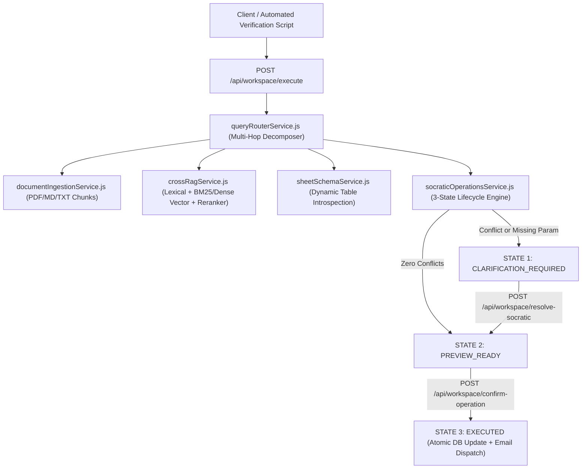

# Backend Implementation Plan: Cross-Document Hybrid RAG (#2) & Socratic Operations Gate (#3)

## Goal Description

Upgrade the backend from isolated lexical context lookup and single-table spreadsheet mutations into a **Generalized Cross-Document Hybrid RAG & Socratic Operations Engine** while keeping 100% backward compatibility with all existing Sheet Management, Customer Inquiry, and Announcement endpoints and tests.

> [!IMPORTANT]
> **Scope & Anti-Hardcoding Guarantees**
> - **Backend Only**: No frontend React components will be modified.
> - **100% Schema-Agnostic & Dynamic**: All document chunking, hybrid retrieval, multi-hop entity extraction, relational binding, conflict detection, row mutation preview/commit, and email drafting operate dynamically via runtime schema introspection and semantic/structural rules—never hardcoding demo filenames, SKUs, column names, or discount numbers.

---

## Phase 0 Reconnaissance Findings

1. **Existing Retrieval & Sheet Pipeline**:
   - [`contextRetrievalService.js`](file:///c:/Users/USER/Desktop/Development/Echo/backend/src/services/contextRetrievalService.js) (lines 79–113) defines domain token clusters, stemmer (`stemWord`), synonym expansion (`LEXICAL_SYNONYM_GROUPS`), `scoreSheetSchemaRelevance`, and `retrieveRelevantContextForBusiness`.
   - [`sheetSchemaService.js`](file:///c:/Users/USER/Desktop/Development/Echo/backend/src/services/sheetSchemaService.js), [`sheetCsvImportService.js`](file:///c:/Users/USER/Desktop/Development/Echo/backend/src/services/sheetCsvImportService.js), [`sheetQueryService.js`](file:///c:/Users/USER/Desktop/Development/Echo/backend/src/services/sheetQueryService.js), and [`sheetMutationService.js`](file:///c:/Users/USER/Desktop/Development/Echo/backend/src/services/sheetMutationService.js) power dynamic table creation, schema discovery (`discoverTableSchema`), and the 2-stage preview/confirmation safeguard (`previewMutation` / `executeMutation`).
   - [`emailService.js`](file:///c:/Users/USER/Desktop/Development/Echo/backend/src/services/emailService.js) provides `sendIndividualEmail`, `setMailTransporter`, and `SMTP_TEST_MODE` (`jsonTransport`).
2. **Demo Assets Inspection (`backend/demo/`)**:
   - `Fulfillment SLA Policy.pdf` (1 page, Policy `POL-SLA-48H-2026`): Specifies a 48-hour fulfillment SLA target window and a mandatory 10% promotional store credit voucher (calculated on product subtotal excluding shipping/taxes) when an order dispatch delay exceeds 48 hours (`> 48h`), plus full refund option at `> 96h`. Encoded with PDF Type3 CID fonts + `/ToUnicode` CMap streams (`beginbfchar` / `beginbfrange`).
   - `Supplier Delay Notice.pdf` (1 page, Reference `ADV-DEL-2026-904`): Specifies a 3 to 5 business day inbound/dispatch delay affecting shipments scheduled for standard dispatch across regional hubs (Dhaka, Chittagong, Sylhet) under emergency protocol Bravo-4.
   - `Commercial Orders Dataset.csv`: Saved as an OpenXML `.xlsx` container (`PK\x03\x04`) with a `.csv` extension where `xl/sharedStrings.xml` contains 17 columns (`Order_ID`, `Order_Date`, `Customer_Name`, `Customer_Email`, `Delivery_City`, `Item_SKU`, `Item_Name`, `Quantity`, `Unit_Price_BDT`, `Order_Subtotal_BDT`, `Shipping_Cost_BDT`, `Total_Amount_BDT`, `Payment_Method`, `Fulfillment_Hub`, `Dispatch_Status`, `Delay_Hours`, `SLA_Voucher_Issued`) and 20 order rows. Our ingestion layer will transparently normalize both raw CSV buffers and OpenXML/XLSX-wrapped CSV containers into tabular records.

---

## Architecture Overview



---

## Proposed Changes

### Component 1: Unstructured Document Ingestion & Spreadsheet Container Normalization

#### [NEW] [documentIngestionService.js](file:///c:/Users/USER/Desktop/Development/Echo/backend/src/services/documentIngestionService.js)
- **PDF, Markdown & Text Parsing**:
  - Implement a zero-dependency native PDF parser that walks `/Type /Page` objects, resolves `/Resources /Font` -> `/ToUnicode` CMap streams (`beginbfchar` and `beginbfrange`), and decodes `BT...ET` text blocks (`Tj`, `TJ`, `Td`, `TD`, `T*`) per page with coordinate-aware line reconstruction, plus fallback plain-text stream extraction.
  - Support `.pdf`, `.md`, `.txt`, and `.json` buffers or file paths.
- **Semantic Chunking & Persistence**:
  - Split extracted page text into semantic chunks preserving section headers and paragraph boundaries with full provenance metadata:
    `{ doc_id, business_id, filename, page_number, chunk_index, section_title, raw_text, token_vector }`.
  - Persist documents and chunks in PostgreSQL (`workspace_documents` and `workspace_document_chunks` tables, auto-ensured via `CREATE TABLE IF NOT EXISTS`) as well as an in-memory business-scoped index so both live PostgreSQL and mock test pools work seamlessly.

#### [MODIFY] [sheetCsvImportService.js](file:///c:/Users/USER/Desktop/Development/Echo/backend/src/services/sheetCsvImportService.js)
- Enhance `normalizeUploadedSpreadsheetBuffer(buffer)`:
  - Detect OpenXML ZIP headers (`PK\x03\x04`) when an `.xlsx`-formatted file is saved with a `.csv` extension.
  - Extract worksheet cell values and `xl/sharedStrings.xml` via `zlib.inflateRawSync`.
  - When a single cell contains a header + space-separated records (where rows are concatenated by whitespace after every $N$-th column), dynamically reconstruct standard newline-delimited CSV rows based on the header's column count $N$ so `detectEntityFromCsv`, `createOrRegisterDynamicTableFromCsv`, and `parseAndValidateSheetCsv` process any such file cleanly without hardcoding column names.

---

### Component 2: Generalized Cross-Document Hybrid RAG & Multi-Hop Router (Feature #2)

#### [NEW] [crossRagService.js](file:///c:/Users/USER/Desktop/Development/Echo/backend/src/services/crossRagService.js)
- **Hybrid Scoring Engine**:
  - Combines the existing stemmer/synonym/keyword scorer from [`contextRetrievalService.js`](file:///c:/Users/USER/Desktop/Development/Echo/backend/src/services/contextRetrievalService.js) with **BM25 + TF-IDF character/word n-gram cosine similarity vectors** (and optional Gemini embedding/semantic reranking when live API keys are active).
  - Retrieves and ranks both unstructured document chunks (`source_type: "document"`) and structured table rows (`source_type: "table"`).
- **Normalized Cross-Source Citations**:
  - Formats every matched document chunk and table row into the standardized citation contract:
    ```json
    {
      "source_type": "document | table",
      "source_name": "Fulfillment SLA Policy.pdf | orders",
      "locator": "Page 1, Chunk 2 | Row Order_ID=ORD-2026-1003",
      "excerpt": "Exact grounded text or serialized row key-values"
    }
    ```
- **Graceful Conversational Fallback**:
  - Detects 1-word greetings or non-domain conversational inputs (e.g., `"Hello"`, `"Hi"`, `"Tell me"`, `"Thanks"`) before throwing empty-match errors and returns `{ conversational_intent: true, category: 'greeting_or_general', citations: [] }` so callers respond naturally.

#### [NEW] [queryRouterService.js](file:///c:/Users/USER/Desktop/Development/Echo/backend/src/services/queryRouterService.js)
- Executes the **3-Step Multi-Hop Execution Graph**:
  1. **Step 1 — Schema & Source Discovery**: Introspects all active CSV-backed tables for the business (`discoverTableSchema`, column names, types, representative values) and all ingested unstructured documents (`listDocumentsForBusiness`).
  2. **Step 2 — Multi-Hop Execution Plan (`HOP_1` -> `HOP_2`)**:
     - `HOP_1 (Unstructured <-> Structured)`: Extracts operational rules, thresholds (e.g., numeric hour thresholds, percentage voucher/discount rules, hub/region filters, status classifications), and target entity conditions from unstructured documents.
     - `HOP_2 (Relational Resolution)`: Binds extracted conditions into parameterized queries against the dynamically matched database table(s) to retrieve candidate affected rows and conflicting rows.
  3. **Step 3 — Provenance & Citations Assembly**: Aggregates document citations (with exact `Page X` locators) and table row citations (with primary business key/row ID locators).

#### [MODIFY] [contextRetrievalService.js](file:///c:/Users/USER/Desktop/Development/Echo/backend/src/services/contextRetrievalService.js)
- Export internal helper functions needed by `crossRagService.js` (`evaluateFieldMatch`, `getCandidateSheetSchemas`, `SYNONYM_LOOKUP`) and integrate `crossRagService` document chunk retrieval into `retrieveRelevantContextForBusiness` so Customer Inquiry also benefits from uploaded unstructured documents and graceful conversational fallback.

---

### Component 3: RAG-Based Operations & Socratic Conflict Gate (Feature #3)

#### [NEW] [socraticOperationsService.js](file:///c:/Users/USER/Desktop/Development/Echo/backend/src/services/socraticOperationsService.js)
- Bridges `queryRouterService` with the Two-Stage Modification Safeguard and `emailService.js`.
- **Persistence**: Stores workflow state (`workflow_id`, `business_id`, `state`, `instruction`, `table_name`, `schema`, `affected_rows`, `conflicting_rows`, `extracted_rules`, `socratic_questions`, `selected_options`, `mutations_preview`, `emails_preview`, `citations`) in both PostgreSQL (`socratic_workflows` table) and an in-memory Map fallback.
- **State Machine**:
  1. **`STATE 1: CLARIFICATION_REQUIRED` (The Socratic Gate)**:
     - Dynamically inspects retrieved document rules against candidate rows in the target table.
     - Detects **Policy/Data Conflicts** (e.g., when a policy rule specifies issuing a voucher/discount/compensation or status update, and a subset of candidate rows already have an existing voucher/discount column set to `true` / non-zero, or when document scope rules create ambiguity between already-flagged rows vs. in-progress rows scheduled at affected hubs).
     - Detects **Missing Critical Parameters** when required mutation fields or email parameters cannot be resolved from either the prompt or the documents.
     - Returns the exact `CLARIFICATION_REQUIRED` contract with `workflow_id`, `conflict_summary`, `affected_rows_count`, `conflicting_rows_count`, `socratic_questions` (each with `question_id`, `question_text`, and `options: [{ option_id, label, rule_interpretation }]`), and `citations`.
  2. **`STATE 2: PREVIEW_READY` (Stage 1 Safeguard Preview)**:
     - Triggered directly when zero conflicts exist OR when `/api/workspace/resolve-socratic` receives `{ workflow_id, selected_options }`.
     - Deterministically computes `mutations_preview` (`[{ table_name, row_identifier, before, after }]`) and `emails_preview` (`[{ recipient_email, customer_identifier, subject, body, metadata: { applied_rule } }]`) grounded in the policy rules and row values.
  3. **`STATE 3: EXECUTED` (Stage 2 Safeguard Commit)**:
     - Triggered when `/api/workspace/confirm-operation` receives `{ workflow_id, confirm: true, dryRun?: boolean }`.
     - Atomically updates all target rows in PostgreSQL according to `mutations_preview`.
     - Dispatches individual personalized emails via `sendIndividualEmail` (supporting `dryRun: true` or test transport when SMTP credentials are not live) and records the dispatched email payloads.
     - Returns `{ status: "EXECUTED", workflow_id, updated_rows_count, dispatched_emails_count, dispatched_emails, citations }`.

---

### Component 4: API Endpoints & Structured JSON Self-Correction Retry (Phase 3)

#### [MODIFY] [geminiService.js](file:///c:/Users/USER/Desktop/Development/Echo/backend/src/services/geminiService.js)
- Add `generateStructuredJsonWithRetry(promptText, validatorFn, { maxRetries = 2, responseSchema = null })`:
  - Enforces strict JSON schema validation on LLM outputs and automatically retries up to `maxRetries` (2 retries) with a self-correction prompt appending the validation/parse error if malformed or schema-invalid JSON is returned.

#### [MODIFY] [uploadMiddleware.js](file:///c:/Users/USER/Desktop/Development/Echo/backend/src/middleware/uploadMiddleware.js)
- Add `uploadWorkspaceFiles` middleware supporting `.pdf`, `.md`, `.txt`, and `.csv` uploads (single or multiple files).

#### [NEW] [workspaceController.js](file:///c:/Users/USER/Desktop/Development/Echo/backend/src/controllers/workspaceController.js) & [workspaceRoutes.js](file:///c:/Users/USER/Desktop/Development/Echo/backend/src/routes/workspaceRoutes.js)
- Expose clean endpoints mounted at `/api/workspace` (and `/api/businesses/:businessId/workspace`):
  - `POST /api/workspace/documents/upload`: Ingests one or more unstructured documents (PDF/MD/TXT) and/or CSV sheets into the workspace.
  - `GET /api/workspace/documents`: Lists ingested workspace documents and chunk counts.
  - `POST /api/workspace/execute`: Executes a natural-language cross-document query or operational workflow (returning `CLARIFICATION_REQUIRED`, `PREVIEW_READY`, or read query results with `citations`).
  - `POST /api/workspace/resolve-socratic`: Accepts `{ workflow_id, selected_options }` (or `selected_option_id`) and transitions a `CLARIFICATION_REQUIRED` workflow to `PREVIEW_READY`.
  - `POST /api/workspace/confirm-operation`: Accepts `{ workflow_id, confirm: true, dryRun?: boolean }` and transitions a `PREVIEW_READY` workflow to `EXECUTED`.
- Also integrate into [`sheetController.js`](file:///c:/Users/USER/Desktop/Development/Echo/backend/src/controllers/sheetController.js) so cross-document operational prompts sent to `/api/sheets/query` or `/api/sheets/mutate` can seamlessly invoke the Socratic Operations / Cross-RAG pipeline when workspace documents are present.

#### [MODIFY] [app.js](file:///c:/Users/USER/Desktop/Development/Echo/backend/src/app.js)
- Mount `workspaceRoutes` at `/api/workspace` and under `/api/businesses/:businessId/workspace`.

---

## Verification Plan

### Automated Tests
1. **New End-to-End 3-Turn Verification Script**:
   - Create [`backend/tests/demo_workflow_verification.js`](file:///c:/Users/USER/Desktop/Development/Echo/backend/tests/demo_workflow_verification.js):
     - Ingests `./backend/demo/Fulfillment SLA Policy.pdf`, `./backend/demo/Supplier Delay Notice.pdf`, and `./backend/demo/Commercial Orders Dataset.csv` into table `orders` using the generalized ingestion functions.
     - **Turn 1**: Sends `"Check which orders in our spreadsheet are affected by this shipment delay, update their status, and notify those customers per our SLA policy."` and asserts `status === "CLARIFICATION_REQUIRED"`, valid `workflow_id`, non-empty `citations` referencing both PDFs and the `orders` table, `affected_rows_count > 0`, `conflicting_rows_count > 0`, and structured `socratic_questions`.
     - **Turn 2**: Submits the Socratic resolution option to `/api/workspace/resolve-socratic` and asserts `status === "PREVIEW_READY"`, non-empty `mutations_preview` with exact `before` and `after` diffs, and `emails_preview` with personalized customer email drafts and valid email addresses.
     - **Turn 3**: Submits `{ workflow_id, confirm: true, dryRun: true }` to `/api/workspace/confirm-operation`, asserts `status === "EXECUTED"`, queries the `orders` database table directly to verify the rows were mutated to the expected `after` values, and verifies the email dispatch payloads were recorded.
   - Run:
     ```powershell
     node --import tsx backend/tests/demo_workflow_verification.js
     ```
2. **Existing Regression Suite**:
   - Run all 65 existing backend tests and TypeScript typecheck to ensure zero regressions:
     ```powershell
     npm run typecheck --prefix backend
     npm test --prefix backend
     ```
